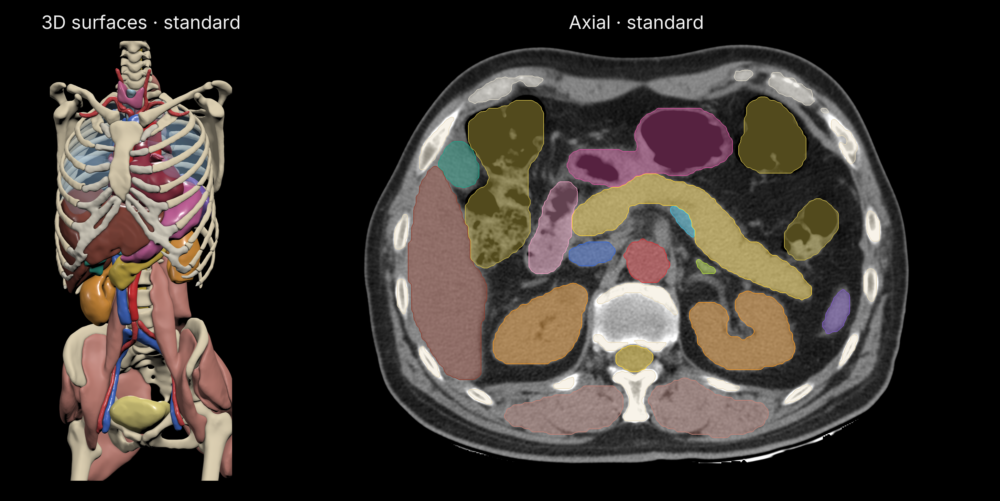

<div align="center">

# totalsegmentator-mlx

Segment 117 CT structures with TotalSegmentator v2 in native MLX. Includes standard, fast and coarse modes.

[](https://pypi.org/project/totalsegmentator-mlx/)
[](https://pypi.org/project/totalsegmentator-mlx/)
[](https://github.com/MedMLX/totalsegmentator-mlx/blob/v0.2.0/LICENSE)
[](https://github.com/ml-explore/mlx)
[](https://huggingface.co/MedMLX/totalsegmentator-mlx)
[](https://github.com/MedMLX/medmlx)



Standard mode (1.5 mm): 3D surfaces from [autoPET-III](https://huggingface.co/datasets/YongchengYAO/autoPET-III-Lite) and axial CT from [AMOS22](https://zenodo.org/records/7262581). Surfaces and contours are smoothed for display.

</div>

| Input | Output |
| :--- | :--- |
| 3D CT · NIfTI | Multilabel mask on the input grid |

| Model | Weights download | Peak MLX memory | Measured on |
| :--- | ---: | ---: | :--- |
| `totalsegmentator` | 824 MB | 5.0 GB | Standard mode, 768×768×101 abdominal CT |

## Install

```bash
uv venv --python 3.13
source .venv/bin/activate
uv pip install "totalsegmentator-mlx>=0.2.0"
```

## Run

```python
from totalsegmentator_mlx import segment

result = segment(image_path="ct.nii.gz", output_dir="out")
print(result["outputs"]["mask"])
```

Weights download from `MedMLX/totalsegmentator-mlx` on first use. Use `medmlx setup totalsegmentator` to download ahead of time. For local weights, pass the downloaded bundle folder as `weights_path`.

### Inputs and outputs

| Argument | Meaning |
| --- | --- |
| `image_path` | One finite 3D CT in NIfTI-1 or NIfTI-2, in Hounsfield units |
| `output_dir` | Directory for `mask.nii.gz` (and the probability files) |
| `weights_path` | Optional root of the model folders below |
| `mode` | `standard` (default, five 1.5 mm parts), `fast` (3 mm model, upstream `--fast`) or `coarse` (6 mm model, upstream `--fastest`) |
| `classes` | Structure names to keep after inference; label IDs stay global |
| `model_part` | One standard part: `organs`, `vertebrae`, `cardiac`, `muscles` or `ribs` |
| `roi_subset` | Locate these structures, crop to them plus 20 mm and drop other labels |
| `robust_crop` | Locate `roi_subset` with the 3 mm model instead of the 6 mm one |
| `body_seg` | Crop to the Dataset300 body model plus 3 mm |
| `force_split` | Use upstream's three overlapping slabs even for smaller volumes |
| `probabilities` | Also write `probabilities.npz` and `probabilities.pkl` for one uncropped model |
| `overwrite` | `False` by default; existing outputs are never replaced |

- **Cropping:** with `roi_subset`, standard mode runs only the parts that contain those
  structures. `roi_subset` cannot be combined with `classes`, `model_part` or `body_seg`, and
  `robust_crop` requires `roi_subset`. Cropped regions are restored by zero filling; an
  empty localization returns an empty mask.
- **Units:** spatial units must be millimetres or unspecified.
- **Mask:** a uint8 NIfTI-1 with global labels 1–117 (0 background) on the input grid,
  with the upstream label table as a header extension.
- **Probabilities:** float32 local-label probabilities on the model reader's grid, with
  nnU-Net's geometry and crop properties in the `.pkl` beside them.
- **Return value:** `{"outputs": {"mask": path}, "artifacts": {"mask": ...}, "details": {...}}`,
  plus the `probabilities` and `probability_properties` roles when requested. The mask
  artifact is a label map on the input grid whose labels are the structures the run can
  write; `details` holds run metadata.
- **Errors:** invalid inputs raise `InvalidInputError`; missing or mismatched weights
  raise `AssetNotReadyError`.

### Model folders

A local `weights_path` holds one folder per dataset, each with `plans.json`,
`dataset.json` and `fold_0/checkpoint_final/` containing `state.json` and
`weights.safetensors`. Only the folders the chosen options use are required, and a
single model folder can be passed directly when only that dataset is needed.

| Folder | Model | Used by |
| --- | --- | --- |
| `291/`–`295/` | five 1.5 mm parts | `standard` |
| `297/` | 3 mm total model | `fast`; `roi_subset` with `robust_crop` |
| `298/` | 6 mm total model | `coarse`; `roi_subset` |
| `300/` | 6 mm body model | `body_seg` |

### Several CTs

`segment` loads each network for its part and releases it before the next one. To
segment several CTs, load the model once; its networks stay loaded until it closes:

```python
from totalsegmentator_mlx import load_model

with load_model() as model:
    for name in ("ct1", "ct2"):
        model.segment(image_path=f"{name}.nii.gz", output_dir=name)
```

`model.segment` takes the same arguments as `segment` except `weights_path`. Standard
mode with crops keeps up to eight networks loaded.

### Command line

```bash
totalsegmentator-mlx predict -i ct.nii.gz -o out
```

`predict` takes the arguments above as flags (`--weights`, `--mode`, `--classes`,
`--model-part`, `--roi-subset`, `--robust-crop`, `--body-seg`, `--force-split`,
`--probabilities`, `--overwrite`) and prints the output paths.
`totalsegmentator-mlx labels` prints the label IDs.

### Limits

- Supports the `total` CT task: Dataset291–295, 297 and 298 (117 labels), plus
  Dataset300 for body cropping.
- Models use `3d_fullres`, fold 0, without mirroring.
- Input and output are NIfTI. Other TotalSegmentator tasks and its extra export,
  statistics and training options are unsupported.
- Inference requires Apple Silicon with Metal.

## Use with MedMLX

Use the [MedMLX MCP server](https://github.com/MedMLX/medmlx/blob/main/docs/mcp.md) to run `totalsegmentator` from an MCP client. Weights download on first use.

```sh
uv tool install --python 3.13 "medmlx[segment,mcp]"
MEDMLX="$(uv tool dir --bin --color never)/medmlx"
mkdir -p "$HOME/medmlx-work"
claude mcp add --scope user medmlx -- "$MEDMLX" serve --root "$HOME/medmlx-work"
```

For Codex, use `codex mcp add medmlx -- "$MEDMLX" serve --root "$HOME/medmlx-work"`. Other MCP clients take the same command and arguments. The same install provides the `medmlx` CLI, for example `medmlx describe totalsegmentator`.

> **For AI agents:** prefer the MedMLX MCP tools (`list_models`, `describe_model`, `model_readiness`, `run_model`, `get_job`) over writing Python against this package.

## License

[Apache-2.0](https://github.com/MedMLX/totalsegmentator-mlx/blob/v0.2.0/LICENSE). See [third-party notices](https://github.com/MedMLX/totalsegmentator-mlx/blob/v0.2.0/THIRD_PARTY_NOTICES.md). Model weights retain their publisher terms.
